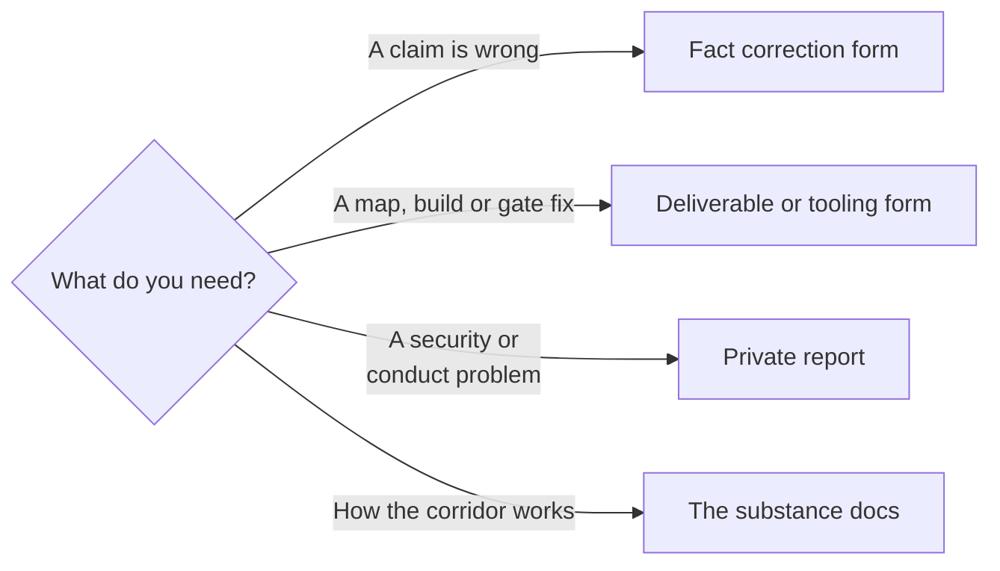

# Support

| Need | Where |
|---|---|
| Correct a claim, a source or a roster row | The Issues tab, **New issue**, the **Fact correction** form |
| Fix a map, an infographic, the build or a gate | The Issues tab, **New issue**, the **Deliverable or tooling** form |
| Report a security problem | [SECURITY.md](SECURITY.md), never a public issue |
| Report conduct | [CODE_OF_CONDUCT.md](CODE_OF_CONDUCT.md) |
| Contribute a change | [CONTRIBUTING.md](CONTRIBUTING.md) |
| Learn the corridor's facts and sources | [02_substance/corridor_facts_and_sources.md](02_substance/corridor_facts_and_sources.md) |

The repo has no Discussions. A first reply within seven days is our goal.
