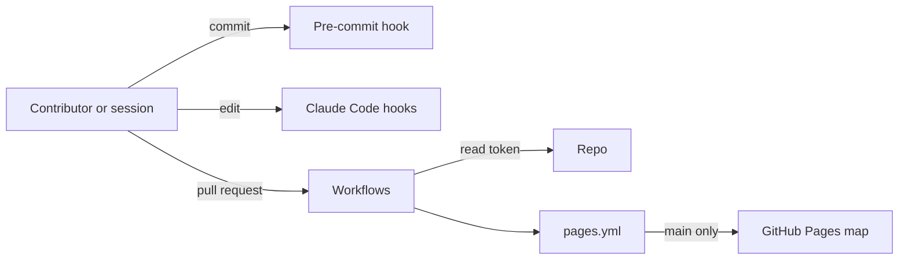

# Threat model

| Read | Covers |
|---|---|
| 2026-11-16 | Every row here, against `main`, with [SECURITY.md](SECURITY.md) |
| Each pull request | Adds a row for a new workflow, secret, write scope or hook |

| Element | Threat | STRIDE | Control | Gap |
|---|---|---|---|---|
| [Workflows](.github/workflows/) | Pull request code gets secrets or writes | Elevation | No `pull_request_target`; `contents: read`; no Actions secrets; fork runs wait for approval | None known |
| [Workflows](.github/workflows/) | An action tag moves | Tampering | Full-SHA pins, required by settings; Dependabot bumps | None known |
| [secret-scan.yml](.github/workflows/secret-scan.yml) | A secret is committed | Disclosure | gitleaks, required on pull requests; push protection | Local scan needs gitleaks |
| [pages.yml](.github/workflows/pages.yml) | The deploy job's write token is misused | Elevation | Write scopes on the deploy job only, from `main` | None known |
| [04_tools/](04_tools/) | A change weakens a gate, then passes it | Tampering | Gate changes get a review | CI runs the changed copy |
| [.githooks/](.githooks/), [.claude/hooks/](.claude/hooks/) | A client-side gate is skipped | Repudiation | Required CI reruns them; Claude cannot pass `--no-verify` | People can, by design |
| Substance docs | A false or stale claim ships | Spoofing | Lint flags bare figures; dated sources; correction form | A person checks the source |
| `main` | An unreviewed change lands | Elevation | Rulesets: pull request, three required checks, no force push | One human maintainer |

Report findings: [SECURITY.md](SECURITY.md).
