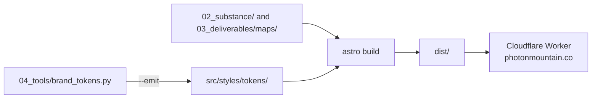

# site

The source of photonmountain.co: a static Astro build served from a Cloudflare Worker. The plan is the [launch plan](https://claude.ai/code/artifact/be3c781d-a557-4b17-9b6a-7b08011309cf).

| Path | Holds |
|---|---|
| `src/styles/tokens/` | `tokens.css` and `tokens.json`, emitted by `python3 04_tools/brand_tokens.py --emit site/src/styles/tokens`. CI fails when they drift |
| `src/styles/global.css` | Base styles, from tokens only |
| `src/layouts/` | The page shell: fonts, meta, footer |
| `src/components/` | One folder per section |
| `src/pages/` | One file per route |
| `public/_headers` | Security headers for every static file |
| `public/favicon.svg` | The one-color Summit Sun mark, copied from `01_doctrine/brand_assets/`; CI fails when it drifts |

| Command, from the repo root | Does |
|---|---|
| `npm run dev` | Local preview on port 3304 |
| `npm run check` | Type-checks the site |
| `npm run build` | Builds into `site/dist/`; CI runs it on every pull request that touches the site |
